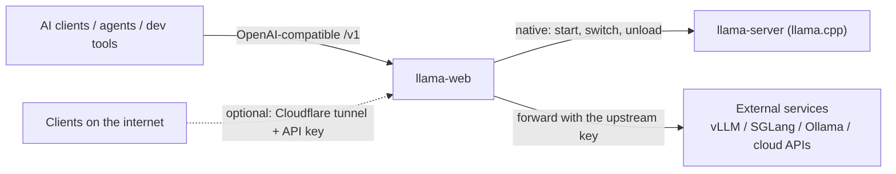

<p align="center">
  
</p>

<h1 align="center">llama-web</h1>

<p align="center"><b>Unified LLM Gateway &amp; llama.cpp Manager</b></p>

<p align="center">
  A lightweight, cross-platform LLM manager and API gateway: local llama.cpp and external AI services behind one entry point.<br>
  It also works as a standalone API gateway, without llama.cpp installed.
</p>

<p align="center">
  <a href="README.md">中文</a> · <b>English</b> ·
  <a href="https://github.com/egoist74110/llama-web/releases">Download</a> ·
  <a href="docs/plan.html">Development plan</a> (Chinese)
</p>

---

## Why it exists

- **AI services are scattered.** Local inference engines, cloud APIs and providers each come with their own address, model names and keys, and every client, agent and dev tool needs them entered again. llama-web gives them one entry point: configure the client once, then switch models and services inside llama-web.
- **llama.cpp is powerful but tedious to run day to day.** Each model needs its own launch arguments; context length, KV cache and GPU offload are maintained by hand; starting, stopping and switching happen on the command line and in scripts. llama-web turns this into a visual manager.
- **No pile of separate tools.** API forwarding, key management, request preprocessing, image compression and remote access would otherwise mean several programs, several configs and several ways to start them. llama-web keeps these everyday features in one process.

## Two capabilities

|  | Native llama.cpp management | Standalone API gateway |
| --- | --- | --- |
| What it is | The local inference engine this project focuses on; llama-web runs its whole lifecycle | Any OpenAI-compatible service connected as an upstream and forwarded through llama-web |
| Needs llama.cpp | Yes (download the official build from the UI) | **No** |
| Scope | Download and versions, model scan, launch arguments, load / unload / switch, memory checks, logs and diagnosis | Forwarding only: no deployment, no start/stop scheduling, no engine-specific parameters |
| For | GGUF models | vLLM, SGLang, Ollama, cloud APIs and other services with a compatible API |

**Supporting another engine's API does not mean managing that engine.** Native management covers llama.cpp only, and goes deep; API compatibility goes wide. llama.cpp has a large community, strong performance, a rich GGUF ecosystem and good Windows / macOS / Linux support. Maintaining model formats, launch arguments and process logic for several engines would multiply the complexity, and that is not what this project is for.



## Quick start

1. **Install**: the installer on Windows, or run from source (Windows / macOS); see [Install](#install).
2. **Add the models or services you use** (pick either path, or both):
   - **API gateway only**: the first visit opens the setup guide; choose "External APIs only": add a service (address including `/v1`, plus its API key) → read its model list ("Test the connection", or type model ids in by hand) → the guide shows the address and model name to enter in your client. No llama.cpp needed.
   - **Local llama.cpp**: choose "Run local models" in the setup guide, four steps: choose a model directory → download and install llama.cpp (official release, SHA-256 checked) → enable models → start.
3. **Point your client at llama-web**:

   | Field | Value |
   | --- | --- |
   | Base URL | `http://<this machine's address>:5001/v1` |
   | API key | Not checked on the LAN, any value works; through the public entry use a key generated by llama-web |
   | model | Local model: `name` or `name:profile`; external service: `connection name-upstream model id` |

4. **When things change, change only llama-web**: new models, new services and new upstream keys are all set up in llama-web; the client's address and key stay the same. `GET /v1/models` lists local models and the external services' models together.

## Features

### Native llama.cpp management

- Scans model directories and reads GGUF metadata; each model can have several parameter profiles, called as `name:profile`
- Loads or switches models automatically from the `model` in each request; one model online at a time by default (switches are queued), and the setting can be changed to load several at once, with a memory estimate and check before each load
- Default parameters tuned to the machine's hardware on first run; live speed, load progress, VRAM and failure diagnosis
- Official llama.cpp versions: a daily check for new releases, manual download or opt-in auto-update (off by default), old versions kept, one-click rollback in the UI
- `llama-server` is started with an argument array and a port assigned by llama-web; the whole process tree is ended on exit, and a llama-server you started yourself is never killed

### Standalone API gateway

- The Connections page registers any OpenAI-compatible service (up to 20); clients call `name-modelid`, and the prefix is removed when forwarding
- llama-web stores each upstream's API key and attaches it when forwarding; the client's own `Authorization` is dropped, and upstream keys never appear in the UI, logs or events
- Upstreams are probed periodically for being online; when an upstream has no `/models`, model ids can be typed in by hand
- A service on this machine can be marked "Exclusive use of this machine": while it is online, llama-web unloads its local models and refuses local loads, so VRAM is not exhausted
- While a service is offline you can save a start command, then start, cancel or stop it from the page (only the process started by this run; no shell; it does not end when llama-web exits)
- JSON requests under `/v1/*` that carry a `model` (chat/completions, completions, embeddings, …) are routed by model name; saving a connection whose prefix would clash with a local model name is refused

### Shared server features

- **Request preprocessing**: image compression, for local models and external services alike (switchable per upstream)
- **Request records**: source (local / LAN / public), key name, allow-listed parameters and token counts (external services must return `usage` in the response); conversation content is never stored
- **Public access (optional)**: a separate `:8080` entry that binds only `127.0.0.1`, serves only `/v1/*` and requires an API key; llama-web runs the Cloudflare tunnel itself, with one-click setup for your own domain or a temporary address without one. See [Public access](docs/public-access.en.md)
- **UI**: Overview / Models / Connections / Chat / Logs / Settings; Chinese / English switched from the left sidebar, applied immediately; follows the system light / dark theme
- **App updates**: the desktop app can download, double-check and install updates; the source version only shows a note

## Install

### Windows desktop app (recommended)

Download `llama-web_<version>_x64-setup.exe` from [Releases](https://github.com/egoist74110/llama-web/releases) and install it (per-user install, no administrator rights needed); the `SHA256SUMS` file on the same page lets you verify it. The installer is not code-signed: when SmartScreen warns, choose "More info → Run anyway". Neither Bun / Node nor llama.cpp needs to be installed beforehand: when you want local models, download llama.cpp from the setup guide or from "Settings → llama.cpp versions". System requirements, verified / unverified environments and known issues are in each version's release notes; build steps and the data directory are in the [Windows desktop notes](docs/windows-desktop.md) (Chinese).

### From source

Requires [Bun](https://bun.sh) (`bun` on your PATH). You do not need to download llama.cpp yourself: when you press download in the UI, the build that suits this machine (CUDA with cudart for NVIDIA on Windows) is downloaded from the official release and its SHA-256 checked.

```bash
bun install
```

### macOS from source

Also requires [Bun](https://bun.sh). Downloading llama.cpp picks the official macOS build for your chip and checks its SHA-256; a Mac has only this one build, so the Settings page has no GPU, device or CPU / GPU switch. There is no installer, in-app update or desktop shell: to upgrade, run `git pull` and then `./start.command build`.

- All data lives in `data/` inside the repository; to uninstall, delete the repository directory (back up `data/` first to keep your configuration).
- When models sit on an external exFAT / network drive, macOS creates `._xxx.gguf` companion files; the scan skips them automatically.
- "Choose folder" uses the system `osascript` dialog; the first time, the system may ask whether Terminal may control other apps. You can also paste a path directly; `~/models` expands to your home directory.
- Archives downloaded from the web carry a quarantine flag; if the system refuses to run a manually added llama.cpp, run `xattr -dr com.apple.quarantine <directory>` in a terminal.
- CI has a macOS job (`bun test`, type check, and running `--version` on the real macOS llama.cpp download). It does not load a model, so Metal inference, the folder dialog and double-click launch from Finder still need confirming on a real Mac.

### Platforms

| Platform | Status |
| --- | --- |
| Windows 11 x64 (NVIDIA GPU or CPU) | Desktop installer + source |
| macOS (Apple Silicon) | Source; the maintainer has run it on an Apple Silicon Mac |
| Linux | Not supported yet |

## Start

Double-click `start.bat` (Windows) or `start.command` (macOS, double-click in Finder; if it says there is no execute permission the first time, run `chmod +x start.command` first). Both just call the same `scripts/launch.ts`. Closing the window or pressing Ctrl+C stops the service and ends every llama-server.

By default this starts the **desktop app** (the same as the installed one: Tauri shell + bundled service): it builds the server when needed, copies it into the shell's resources, then compiles and runs the shell (needs [Rust](https://rustup.rs); the first compile takes a few minutes, later ones are incremental). The shell uses its own data directory, not the repository's `data/`; to change it, set the environment variable `LLAMA_WEB_DATA` (absolute path). If you only want the service and to open it in a browser, add `web`.

When a build exists it shows whether the source changed since the last build and gives a 3-second countdown: if the source changed the default is to rebuild, otherwise to run as is; press `b` to rebuild, `r` to run, `q` to quit, or Enter for the default. With no build it installs dependencies and builds automatically.

```bash
start.bat          # ask (default depends on whether the source changed); on macOS use ./start.command
start.bat build    # always rebuild, then run
start.bat run      # no question, run the last build
start.bat web      # start only the service (open it in a browser); can be combined with build / run
```

The same on both platforms from the command line: `bun run start`, `bun run start:build`, `bun run start:run`, `bun run start:web`.

The default address is `http://localhost:5001` (it listens on `0.0.0.0`, so it is reachable on the LAN with every feature and no key). The first visit opens the setup guide, where you choose "Run local models" or "External APIs only"; once a model or an external service has been added, the guide disappears from the left.

## Configuration

Everything is in `data/` (never committed to Git; set `LLAMA_WEB_DATA` to change the directory):

| File | Contents |
| --- | --- |
| `settings.json` | Ports, model directories, default parameters, scheduling, image compression, log retention, llama.cpp versions, interface language, etc. |
| `models.json` | Enabled models and parameter profiles |
| `upstreams.json` | Connected external services (address, model list, start command, …; no keys) |
| `secrets.json` | API keys, upstream keys, tunnel token, Cloudflare API token (stored in plain text; masked in the UI by default, kept out of logs and request records) |
| `templates/` | Custom chat templates |
| `runtime/` | Downloaded llama.cpp version directories, and cloudflared for the tunnel (`runtime/cloudflared/`) |
| `logs/` | Model output, events, request records (request records contain no conversation content) |

Almost every setting can be changed on the Settings page. `keepVersions` and `cudaRuntime` can currently only be edited by hand in `settings.json` (`cudaRuntime` empty = pick the CUDA runtime automatically from the GPU driver and compute capability, a version number = pick it manually). Config files are written atomically and a backup is kept (`data/backups/`).

## Updates

**llama.cpp**: a daily check for new official releases shows a note next to the version number in "Settings → llama.cpp versions", where you can check and download by hand; the auto-update switch is off by default, and when on, new versions are downloaded, checked, unpacked into a new version directory and used. A network failure only records an event and the old version keeps being used. The last 2 versions are kept by default (the version a running model uses is never deleted) and you can switch / roll back by hand (with a confirmation box); when a model fails to load on a new version the failure card suggests a rollback. A running model keeps its original runtime; the new version is used the next time it is loaded after unloading. The CPU channel joins the daily check and updates only after its first manual download; manually added runtimes are never updated automatically.

**llama-web itself**: "Settings → About & updates" shows the current version, and auto-update is on by default: when due it checks about 15 seconds after opening, and while running checks GitHub Releases once a day. With auto-update off it still checks daily and only shows a note next to the version number; you can check, update or skip this version by hand. The check time is saved across restarts and a failed check counts toward the daily interval; a manual check can be made at any time. Release notes are never popped up and no banner is shown at the top.

- Desktop app: with auto-update on, the installer is downloaded automatically; with it off, you click "Update now" to download and confirm "Close and install". The download counts as complete only when the GitHub asset digest and `SHA256SUMS` both match; installing stops all models and services, the desktop shell verifies it again before launching the installer, and the app reopens by itself afterwards. Settings and data are kept.
- Source version: only shows a note and opens the release page; nothing is installed automatically.
- Users on a pre-release receive later pre-releases and stable releases; users on a stable release receive stable releases only.

## Design principles

- **Lightweight** means: simple to install and use, few external dependencies, no companion services to deploy, llama.cpp optional, as little CPU and memory as possible when idle, and one technology stack (Nuxt / Vue / Bun / Nitro / Tauri). Performance work follows measured data.
- **Boundary**: only llama.cpp is managed natively; other engines are connected through their API, and llama-web does not deploy or manage their processes.
- **Safe defaults**: the public entry binds only to this machine, serves only `/v1/*` and requires a key; secrets stay out of logs; conversation content is never stored.

Keep the complexity inside the tool, and leave the simplicity to the people using it.

## Development

```bash
bun run dev          # dev mode (Node dev server; no public entry)
bun test             # unit tests
bun run typecheck    # type check
bun run build        # build into .output/
```

Pre-commit check (refuses files under `data/` and suspected secrets: `sk-…`, long hex strings, Bearer tokens). Enable it once per clone:

```bash
git config core.hooksPath scripts
```

When a value is deliberately fake (a test fixture), mark the line with `pre-commit:allow`.

Development conventions and the directory layout are in [`AGENTS.md`](AGENTS.md) (Chinese); the development plan and key decisions are in [`docs/plan.html`](docs/plan.html) (Chinese).

### Releasing (maintainers)

GitHub Actions → "Windows release (draft)" → run it with the same version number as `package.json`. On a Windows runner the workflow installs frozen dependencies, tests, type-checks and builds the NSIS package, checks the files inside the package against an allowlist with `desktop/check-package.ts` (rejecting data / secrets / .env / logs / local paths), generates SHA256SUMS and a build manifest, and creates a **draft** prerelease; the release notes come from `docs/release-notes/v<version>.md`. Download the installer from the draft to accept it, then publish by hand (the tag is only created on publishing).

## Icon

The app icon is an AI-generated character in the style of the Qwen mascot (long blue-violet hair, hair ornaments, a folding fan, cherry blossoms); the small icon sizes use a close-up of the face. llama-web has no connection with Qwen or Alibaba and is not an official project.
