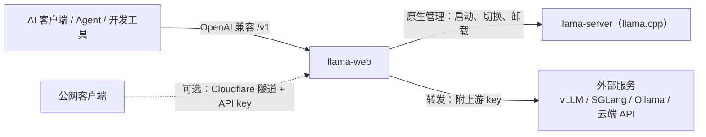

<p align="center">
  
</p>

<h1 align="center">llama-web</h1>

<p align="center"><b>Unified LLM Gateway &amp; llama.cpp Manager</b></p>

<p align="center">
  轻量的跨平台 LLM 管理与 API 网关：把本地 llama.cpp 和外部 AI 服务收进同一个入口。<br>
  不装 llama.cpp，也可以单独当 API 网关用。
</p>

<p align="center">
  <b>中文</b> · <a href="README.en.md">English</a> ·
  <a href="https://github.com/egoist74110/llama-web/releases">下载</a> ·
  <a href="docs/plan.html">开发计划</a>
</p>

---

## 为什么做它

- **服务太分散**：本地推理引擎、云端 API、各家提供商各有一套地址、模型名和密钥，每个客户端、Agent、开发工具又要分别配一遍。llama-web 给它们一个统一入口：客户端只配一次，后面换模型、换服务都在 llama-web 里改。
- **llama.cpp 很强，但日常管理不方便**：不同模型要不同启动参数，上下文、KV Cache、GPU Offload 要手动维护，启动、停止、切换都靠命令行和脚本。llama-web 把这些做成可视化管理。
- **不想拼一堆基础设施**：API 转发、Key 管理、请求预处理、图片压缩、远程访问，各用一个开源工具就是多套程序、多份配置、多种启动方式。llama-web 把这些常用能力收进一个进程。

## 两种能力

|  | llama.cpp 原生管理 | 独立 API 网关 |
| --- | --- | --- |
| 是什么 | 项目重点支持的本地推理引擎，llama-web 负责它的全部生命周期 | 把任意 OpenAI 兼容服务接成上游，统一从 llama-web 转发 |
| 需要 llama.cpp 吗 | 需要（可在界面里一键下载官方版本） | **不需要** |
| 管理范围 | 下载与版本、模型扫描、启动参数、加载 / 卸载 / 切换、显存检查、日志与诊断 | 只转发 API，不部署、不启停调度、不适配私有参数 |
| 适用对象 | GGUF 模型 | vLLM、SGLang、Ollama、云端 API 等接口兼容的服务 |

**支持其他引擎的 API，不等于管理其他引擎。** 原生管理只做 llama.cpp 一种，把它做深；API 兼容尽量做广。llama.cpp 用户多、性能好、GGUF 生态丰富、Windows / macOS / Linux 都适配良好；同时维护多种引擎的模型格式、启动参数和进程逻辑，复杂度会翻倍，这不是本项目要做的事。



## 快速开始

1. **安装**：Windows 用安装包；也可以用源码运行（Windows / macOS），见[安装](#安装)。
2. **添加你要用的模型或服务**（两条路可以只选一条，也可以都用）：
   - **只当 API 网关**：首次打开会进入新手引导，选「只接入外部 API」：添加服务（地址含 `/v1`，填上游 API key）→ 读取模型列表（「测试连接」，或手填模型 id）→ 引导直接给出客户端要填的地址和模型名。不需要 llama.cpp。
   - **本地 llama.cpp**：在新手引导里选「运行本地模型」，四步：选择模型目录 → 下载并安装 llama.cpp（官方 Release，校验 SHA-256）→ 启用模型 → 启动。
3. **在客户端里接入 llama-web**：

   | 项 | 填什么 |
   | --- | --- |
   | Base URL | `http://<本机地址>:5001/v1` |
   | API key | 局域网不校验，随便填；走公网入口时填 llama-web 生成的 key |
   | model | 本地模型：`名字` 或 `名字:方案`；外部服务：`接入名称-上游模型id` |

4. **以后有变化，只改 llama-web**：换模型、加服务、换上游 key 都在 llama-web 里完成，客户端的地址和 key 不用动。`GET /v1/models` 会同时列出本地模型和外部服务的模型。

## 功能

### llama.cpp 原生管理

- 扫描模型目录、读取 GGUF 元数据；每个模型可建多套参数方案，用 `名字:方案` 调用
- 按请求里的 `model` 自动加载或切换模型；默认同一时间在线 1 个（排队切换），可在设置里改成同时加载多个，加载前做内存预估与检查
- 首次运行按本机硬件给出默认参数；实时速度、加载进度、显存、失败诊断
- 官方 llama.cpp 版本管理：每天检查新版本，可手动下载或开启自动更新（默认关闭），保留旧版本，界面一键回退
- 启动 `llama-server` 时只传参数数组、端口由 llama-web 分配；退出时结束整个进程树，不误杀你自己手动启动的 llama-server

### 独立 API 网关

- 「接入」页登记任意 OpenAI 兼容服务（最多 20 个），客户端用 `名称-模型id` 调用，转发时去掉前缀
- 上游 API key 由 llama-web 保存并在转发时附上；客户端自己的 `Authorization` 会被丢弃，上游 key 不出现在页面、日志和事件里
- 定期探测上游是否在线；上游没有 `/models` 时可手填模型 id
- 本机上的服务可勾选「独占本机」：它在线时 llama-web 卸载本地模型、拒绝本地加载，避免显存被挤爆
- 服务不在线时，可保存一条启动命令，在页面里启动、取消或关闭（只管这一次运行启动的进程，不经 shell，llama-web 退出时不结束它）
- `/v1/*` 下带 `model` 的 JSON 请求（chat/completions、completions、embeddings 等）都会按模型名路由；本地模型名与外部前缀冲突时保存会被拒绝

### 共用的服务端能力

- **请求预处理**：图片压缩，本地模型和外部服务都适用（每个上游可单独开关）
- **请求记录**：来源（本机 / 局域网 / 公网）、key 名称、白名单参数、token 数（外部服务需在响应里返回 `usage`）；不保存对话内容
- **公网访问（可选）**：独立的 `:8080` 入口，只绑 `127.0.0.1`、只开放 `/v1/*`、必须带 API key；由 llama-web 托管 Cloudflare 隧道，有域名可一键配置，没有域名可用临时地址。详见 [公网访问](docs/public-access.md)
- **界面**：总览 / 模型 / 接入 / 对话 / 日志 / 设置；中文 / English 在左侧栏切换，立即生效；跟随系统深浅色
- **应用更新**：桌面版可自动下载、双重校验后安装；源码版只提示

## 安装

### Windows 桌面版（推荐）

从 [Releases](https://github.com/egoist74110/llama-web/releases) 下载 `llama-web_<版本>_x64-setup.exe` 安装（当前用户安装，不需要管理员权限），可用同页的 `SHA256SUMS` 核对。安装包未做代码签名，SmartScreen 提示时选「更多信息 → 仍要运行」。不需要安装 Bun / Node，也不需要预装 llama.cpp：要跑本地模型时，在新手引导或「设置 → llama.cpp 版本」里下载即可。系统要求、已验证 / 未验证的环境和已知问题见每个版本的发布说明，构建方式与数据目录见 [Windows 桌面记录](docs/windows-desktop.md)。

### 源码版

需要 [Bun](https://bun.sh)（装好后 `bun` 在 PATH 里）。不需要自己下载 llama.cpp：在界面里点下载时，会从官方 Release 下载适合本机的版本（Windows NVIDIA 为 CUDA 版，含 cudart）并校验 SHA-256。

```bash
bun install
```

### macOS 源码版

同样需要 [Bun](https://bun.sh)。下载 llama.cpp 时会按芯片选择官方 macOS 版并校验 SHA-256；Mac 只有这一种版本，设置页里没有显卡、设备或 CPU / GPU 切换。没有安装包、应用内更新和桌面壳：升级时 `git pull` 后运行 `./start.command build`。

- 数据都在仓库下的 `data/`；卸载 = 删除仓库目录（想保留配置先备份 `data/`）。
- 模型放在外置 exFAT / 网络盘时，macOS 会产生 `._xxx.gguf` 伴随文件，扫描会自动跳过它们。
- 「选择文件夹」使用系统的 `osascript` 对话框；第一次使用时系统可能询问是否允许终端控制其他应用。也可以直接粘贴路径，`~/models` 会展开成你的主目录。
- 从网上下载的压缩包会带隔离标记；手动添加的 llama.cpp 若被系统拒绝运行，需要在终端执行 `xattr -dr com.apple.quarantine <目录>`。
- CI 里有 macOS 作业（`bun test`、类型检查、下载真实 macOS 版 llama.cpp 运行 `--version`），它不加载模型，Metal 推理、选择文件夹对话框和 Finder 双击启动仍需真机确认。

### 平台

| 平台 | 状态 |
| --- | --- |
| Windows 11 x64（NVIDIA GPU 或 CPU） | 桌面安装包 + 源码版 |
| macOS（Apple Silicon） | 源码版；维护者已在 Apple Silicon Mac 上运行验证 |
| Linux | 未适配 |

## 启动

双击 `start.bat`（Windows）或 `start.command`（macOS，Finder 里双击；第一次若提示没有执行权限，先 `chmod +x start.command`）。两者都只是调用同一个 `scripts/launch.ts`。关闭窗口或按 Ctrl+C 即停止服务并结束所有 llama-server。

默认启动**桌面版**（和安装包里的应用一样：Tauri 壳 + 内置服务）：先按需构建服务端，再把它复制进壳的资源目录，编译并运行壳（需要 [Rust](https://rustup.rs)；第一次编译要几分钟，之后是增量）。壳用它自己的数据目录，不是仓库的 `data/`；要换目录，设置环境变量 `LLAMA_WEB_DATA`（绝对路径）。只想要服务、用浏览器打开，加 `web`。

有构建产物时会显示「源码自上次构建后是否有改动」，并给 3 秒倒计时：源码有改动默认重新构建，没改动默认直接运行；按 `b` 重新构建、`r` 直接运行、`q` 退出，按 Enter 取默认。没有构建产物时自动安装依赖并构建。

```bash
start.bat          # 询问（默认按源码是否改动）；macOS 用 ./start.command
start.bat build    # 总是重新构建后运行
start.bat run      # 不询问，直接运行上次的构建
start.bat web      # 只启动服务（浏览器打开），可和 build / run 组合
```

两端通用的命令行写法（效果相同）：`bun run start`、`bun run start:build`、`bun run start:run`、`bun run start:web`。

默认地址 `http://localhost:5001`（监听 `0.0.0.0`，局域网可访问，完整功能，不需要 key）。第一次打开会进入新手引导，可选「运行本地模型」或「只接入外部 API」；添加了模型或外部服务后，引导会从左侧消失。

## 配置

所有配置在 `data/`（不会进入 Git；改目录用环境变量 `LLAMA_WEB_DATA`）：

| 文件 | 内容 |
| --- | --- |
| `settings.json` | 端口、模型目录、默认参数、调度、图片压缩、日志保留、llama.cpp 版本、界面语言等 |
| `models.json` | 已启用的模型和参数方案 |
| `upstreams.json` | 接入的外部服务（地址、模型列表、启动命令等，不含 key） |
| `secrets.json` | API key、上游 key、隧道 token、Cloudflare API token（明文保存；界面默认打码，不进日志和请求记录） |
| `templates/` | 自定义聊天模板 |
| `runtime/` | 下载的 llama.cpp 版本目录，以及隧道用的 cloudflared（`runtime/cloudflared/`） |
| `logs/` | 模型输出、事件、请求记录（请求记录不含对话内容） |

绝大部分设置可以在界面「设置」页修改。`keepVersions`、`cudaRuntime` 目前只能手改 `settings.json`（`cudaRuntime` 留空 = 按显卡驱动和算力自动选 CUDA 运行库，填版本号 = 手动指定）。配置文件写入是原子的并保留备份（`data/backups/`）。

## 更新

**llama.cpp**：每天检查官方新版本，在「设置 → llama.cpp 版本」里的版本号旁提示，可手动检查和下载；自动更新开关默认关闭，开启后自动下载、校验、解压到新的版本目录并使用。网络失败只记事件，继续用旧版本。默认保留最近 2 个版本（正在运行的模型所在版本不会被删），可手动切换 / 回退（有确认框）；新版本加载失败时失败卡片会提示回退。正在运行的模型继续使用原来的运行库，卸载后再加载才使用新版本。CPU 通道在首次手动下载后才参加每日检查和更新；手动添加的运行库不自动更新。

**llama-web 本身**：「设置 → 关于与更新」显示当前版本，自动更新默认开启：到期时在打开后约 15 秒检查，运行期间每天检查一次 GitHub Releases。关闭自动更新后仍每天检查，仅在版本号旁提示新版，可手动检查、更新或跳过此版本。检查时间跨重启保存，失败也计入每日间隔；手动检查可随时进行。不会自动弹出更新说明或显示顶部横幅。

- 桌面版：开启自动更新时会自动下载安装包；关闭时由用户点击「立即更新」下载、确认「关闭并安装」。GitHub 资产摘要与 `SHA256SUMS` 都一致才算下载完成；安装会停止所有模型和服务，桌面壳再次校验后启动安装程序，装完自动重新打开。配置和数据保留。
- 源码版：只提示和打开发布页面，不自动安装。
- 预发布版用户会收到更新的预发布和正式版；正式版用户只收到正式版。

## 设计原则

- **轻量**是指：安装和使用简单，外部依赖少，不需要额外部署配套服务，llama.cpp 可选，空闲时尽量少占 CPU 和内存，技术栈统一（Nuxt / Vue / Bun / Nitro / Tauri）。性能优化以实测数据为准。
- **边界**：只原生管理 llama.cpp；其他引擎只按 API 接入，不负责部署和进程管理。
- **安全默认**：公网入口只绑本机、只开放 `/v1/*`、强制 key；密钥不进日志；不保存对话内容。

把复杂性留在工具内部，把简单留给使用者。

## 开发

```bash
bun run dev          # 开发模式（Node 开发服务器；没有公网入口）
bun test             # 单元测试
bun run typecheck    # 类型检查
bun run build        # 构建到 .output/
```

提交前检查（拒绝提交 `data/` 下的文件和疑似密钥：`sk-…`、长十六进制串、Bearer token）。每个克隆启用一次：

```bash
git config core.hooksPath scripts
```

确认是故意写的假值（测试夹具）时，在该行加标记 `pre-commit:allow`。

开发约定、目录说明见 [`AGENTS.md`](AGENTS.md)；开发计划与关键决定见 [`docs/plan.html`](docs/plan.html)。

### 发布（维护者）

GitHub Actions →「Windows release (draft)」→ 输入与 `package.json` 相同的版本号运行。流程在 Windows runner 上冻结依赖安装、测试、类型检查、构建 NSIS 包，用 `desktop/check-package.ts` 按 allowlist 检查包内文件（拒绝 data / secrets / .env / 日志 / 本机路径），生成 SHA256SUMS 与构建清单，创建**草稿** prerelease；发布说明取自 `docs/release-notes/v<版本>.md`。从草稿下载安装包验收后再手动发布（发布时才创建 tag）。

## 图标

应用图标是用 AI 生成的千问风格角色形象（蓝紫长发、发饰、折扇、樱花），小尺寸图标用脸部特写。llama-web 与 Qwen、阿里巴巴没有任何关联，也不是官方项目。
